# huodongxing-cli (`huodongxing` / `hdx`)

> Production-grade Agentic CLI, JavaScript SDK, and OpenCLI adapter suite for **Huodongxing (活动行 · `https://www.huodongxing.com/`)** event discovery, ticket passes, RFC 5545 iCalendar (`.ics`) export, attendee center, and organizer console automation.

[](https://www.gnu.org/licenses/agpl-3.0)
[](https://nodejs.org/)

---

## ✨ Key Capabilities

1. **Dual-Engine Execution (`auto` | `direct` | `opencli`)**:
   - **Direct HTTP Engine (`direct`)**: High-speed Node native `fetch` with sequential token-bucket WAF pacing (`RequestPacer`, default `900ms` spacing) and `HDXWAFID` cookie persistence.
   - **OpenCLI Browser Bridge (`opencli`)**: Executes in-origin `fetch()` inside an authenticated browser session (`opencli browser work eval`) to bypass Geetest v3 slider challenges (`verify.huodongxing.com/gt3`) with zero manual interaction.
   - **Auto Engine (`auto`)**: Seamlessly routes public queries and authenticated user/console queries across engines with automatic cookie bootstrap.
2. **Complete 12-Area Functional Coverage**:
   - **Public Discovery (Areas 01–06)**: Featured Portal (`/`), Multi-Facet Event Search (`/events`), Event Detail & Inline Ticket/Form Schema (`/event/<id>`), Organizers Directory (`/zhubanfang`), Popularity Ranklist (`/ranklist`), and Special Topics (`/topic`).
   - **Attendee User Center (Areas 07–10)**: Activity Timeline (`/user/index`), Electronic Ticket Passes & QR Vouchers (`/user/regevents`, `/user/tikcets`), Favorites & Followed Organizers (`/user/userfollows`), and Reversible Profile Settings (`/account/profile`, `POST /profile`).
   - **Organizer Console (Areas 11–12)**: Organizer Console Dashboard & Hawk SHA-256 MAC status (`/console/home`) and Published Events Management (`/console/eventadmin`, `POST /console/userpubevents`).
3. **Pre-Socket Security Route Denylist (`SecurityGuard`)**:
   - Deterministic pre-socket guard blocks account deletion, password/binding changes, published event deletion/cancellation, attendee ticket cancellation/refund, and cashier/payment routes before any network request is sent.
4. **Diagnostic-First Observability (`diagnose` — 能读 / 能试 / 能调)**:
   - **能读 (`--read-config`)**: Inspect effective configuration, source priority (`default < config_file < environment < cli_override`), upstream OpenCLI `d=ts` + city alias + promo banner owner fix status, and active security rules.
   - **能试 (`--sample <url|id>`)**: Pass any URL, path, event ID, or city/region token (`foshan,guangzhou,shenzhen`) to inspect route classification, matched parser, and pre-socket security verdict using the real runtime engine.
   - **能调 (`--set-config` / `--reset-config`)**: Adjust operator runtime settings (`~/.config/huodongxing-cli/config.json`) without modifying code constants.
5. **Regional Recommendation Engine (`recommend` — 佛山 · 广州 · 深圳 Default)**:
   - Multi-city discovery across **Foshan, Guangzhou, and Shenzhen (`佛山, 广州, 深圳` / `foshan, guangzhou, shenzhen`)** or region presets (`gba`, `gba-full`, `yrd`, `jjj`, `sw`) with bilingual city alias normalization, static promotional banner filtering, past-event exclusion (`upcomingOnly`), cross-city deduplication, and multi-factor relevance scoring (`recommendScore` 0–100).
6. **Persistent Watchlist CRUD & iCalendar (`.ics`) Export**:
   - Server-side and CLI-backed watchlist (`~/.config/huodongxing-cli/watchlist.json`) with priority sorting, inline notes, soft-delete (`archived`) / restore (`saved`), permanent delete, and one-command RFC 5545 `.ics` calendar export (`hdx export-ics`, `/api/recommend/ics`, `/api/watchlist/ics`).
7. **Interactive Web Console & Real-Time SSE Inspector (`hdx serve`)**:
   - Launch `hdx serve --port 4173` (or `npm run serve`) for the zero-facade Regional Recommendation, Watchlist & Diagnostic Web Console featuring live SSE push (`/api/stream`), Event Detail & Ticket Schema modal inspection, and unified `能读 / 能试 / 能调` controls.

---

## 🚀 Quick Start

```bash
# Clone and install
git clone https://github.com/vecyang1/huodongxing-cli.git
cd huodongxing-cli
npm install
npm link

# Verify CLI & run offline diagnostic reconciler
huodongxing --version
hdx diagnose --offline

# Launch the Regional Recommendation & Diagnostic Web Console
hdx serve --port 4173
```

---

## 🛠️ CLI Command Reference

```bash
# 1. Public Discovery & Regional Recommendations (Defaults to 佛山·广州·深圳 / --region gba)
hdx recommend --limit 15 -f table
hdx recommend --region gba --keywords "AI,出海,跨境,饰品" -f table
hdx recommend --cities "foshan,guangzhou,shenzhen" --limit 20
hdx events --cities "佛山,广州,深圳" --upcoming-only --limit 15 -f table
hdx events --keyword "AI" --city "shenzhen" --limit 10 -f table
hdx events --keyword "具身智能" --date 2026-10-01 --date-to 2026-10-31
hdx detail 2871552596500
hdx organizers --limit 10 -f table
hdx ranklist --limit 10 -f table
hdx topics --limit 10 -f md

# 2. Persistent Watchlist & Web Console Server
hdx watchlist list -f table
hdx watchlist add 2882671341711 --title "【佛山站】2026亚马逊卖家年度增长峰会" --city "佛山" --priority high --note "顺德卖家峰会"
hdx watchlist update 2882671341711 --status attending --note "周四下午准时出席"
hdx watchlist archive 2882671341711
hdx watchlist restore 2882671341711
hdx watchlist remove 2882671341711
hdx watchlist export-ics --output ./watchlist.ics
hdx serve --port 4173

# 3. Authenticated User Center
hdx status
hdx timeline --limit 10 -f table
hdx tickets --status all -f table
hdx ticket-detail <tid>
hdx favorites -f table
hdx following -f table
hdx profile
hdx profile-set --brief "AI & Robotics Builder" --dry-run
hdx profile-set --brief "AI & Robotics Builder" --execute
hdx register 2871552596500 --ticket-sn 1 --dry-run
hdx export-ics --output ./my-tickets.ics

# 4. Organizer Console
hdx console-home
hdx console-events --status all -f table

# 5. Diagnostic & Observability (能读 / 能试 / 能调)
hdx diagnose
hdx diagnose --read-config
hdx diagnose --sample "foshan,guangzhou,shenzhen"
hdx diagnose --sample "https://www.huodongxing.com/event/2871552596500"
hdx diagnose --sample "https://www.huodongxing.com/payment/cashier" --method POST
hdx diagnose --set-config --key defaultCities --value "佛山,广州,深圳"
hdx diagnose --set-config --key minIntervalMs --value 1000
hdx diagnose --reset-config
```

Supported output formats (`-f, --format`):
- `json` (default structured output for AI agents)
- `table` (aligned terminal table)
- `md` (GitHub Flavored Markdown table)
- `csv` (RFC 4180 CSV)

---

## 📦 JavaScript / Node.js SDK Usage

```js
import {
  HuodongxingClient,
  WatchlistStore,
  createConsoleServer,
  classifySample,
} from 'huodongxing-cli';

const client = new HuodongxingClient({
  engine: 'auto', // 'auto' | 'direct' | 'opencli'
  minIntervalMs: 900,
});

// Smart regional recommendations across Foshan, Guangzhou, and Shenzhen (GBA default)
const rec = await client.recommendEvents({
  region: 'gba', // or cities: ['foshan', 'guangzhou', 'shenzhen']
  limit: 15,
});
console.log(rec.byCity['佛山'], rec.byCity['广州'], rec.byCity['深圳']);

// Search public events
const search = await client.searchEvents({ keyword: '机器人', city: '深圳', limit: 5 });
console.log(search.items);

// Fetch rich event detail (inline ticket tiers & registration form schema)
const detail = await client.getEventDetail('2871552596500');
console.log(detail.title, detail.tickets, detail.formItems);

// Persistent Watchlist CRUD & RFC 5545 .ics export
const store = new WatchlistStore();
store.upsert({ id: '2882671341711', title: '佛山站跨境峰会', city: '佛山', priority: 'high' });
const watchlistIcs = store.exportIcs();

// Start the Web Console & SSE Diagnostic Server
const srv = createConsoleServer({ client });
const { url } = await srv.listen(4173, '127.0.0.1');
console.log('Web Console running at:', url);

// Test a sample route against the pre-socket security guard
console.log(classifySample('/payment/cashier', { method: 'POST' }));
```

---

## 🔌 OpenCLI Adapter Suite (`opencli huodongxing <cmd>`)

The `opencli-adapter/` directory provides 15 SSOT-backed OpenCLI commands that delegate directly to `src/index.js`:

| Command | Access | Strategy | Description |
| :--- | :--- | :--- | :--- |
| `opencli huodongxing recommend` | `read` | `PUBLIC` | Smart regional recommendations (`佛山·广州·深圳` default, `--region`, `--cities`) |
| `opencli huodongxing digest` | `read` | `PUBLIC` | 5-track ecosystem intelligence digest (cross-border, AI, short drama, infra, apps) |
| `opencli huodongxing events` | `read` | `PUBLIC` | Search & filter public events (with `d=ts` date-range fix, `status=1` upcoming filter, `--cities`, `--region`, `--upcomingOnly`) |
| `opencli huodongxing detail <id>` | `read` | `PUBLIC` | Event detail, ticket tiers & registration form schema |
| `opencli huodongxing organizers` | `read` | `PUBLIC` | Featured event organizers directory |
| `opencli huodongxing ranklist` | `read` | `PUBLIC` | Popularity & heat index ranklist |
| `opencli huodongxing topics` | `read` | `PUBLIC` | Curated special topics & collections |
| `opencli huodongxing timeline` | `read` | `COOKIE` | Personal activity timeline (`/user/index`) |
| `opencli huodongxing tickets` | `read` | `COOKIE` | Personal registered tickets (`/user/regevents`) |
| `opencli huodongxing favorites` | `read` | `COOKIE` | Favorited events (`/user/userfollows`) |
| `opencli huodongxing following` | `read` | `COOKIE` | Followed organizers (`/user/userfollows`) |
| `opencli huodongxing profile` | `read` | `COOKIE` | Account profile settings (`/account/profile`) |
| `opencli huodongxing console-home` | `read` | `COOKIE` | Organizer console dashboard (`/console/home`) |
| `opencli huodongxing console-events` | `read` | `COOKIE` | Organizer published events (`/console/eventadmin`) |
| `opencli huodongxing diagnose` | `read` | `PUBLIC` | Diagnostic reconciler & sample classifier |

---

## 🖼️ Visual Capability Tour (14 Functional & Web Console Surfaces, PII-Sanitized)

| Area | Route | Screenshot |
| :--- | :--- | :--- |
| **01. Home Portal** | `GET /` | 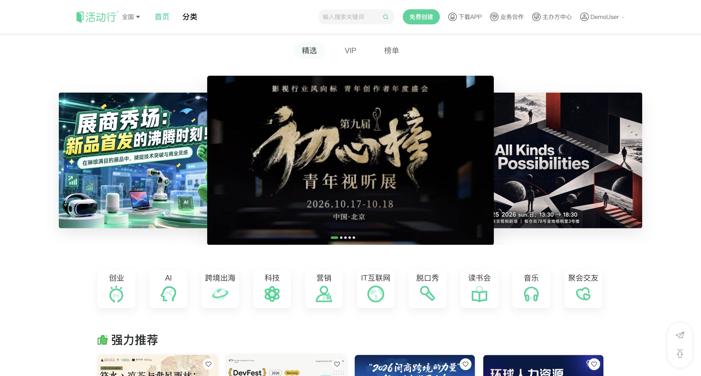 |
| **02. Events Search** | `GET /events` | 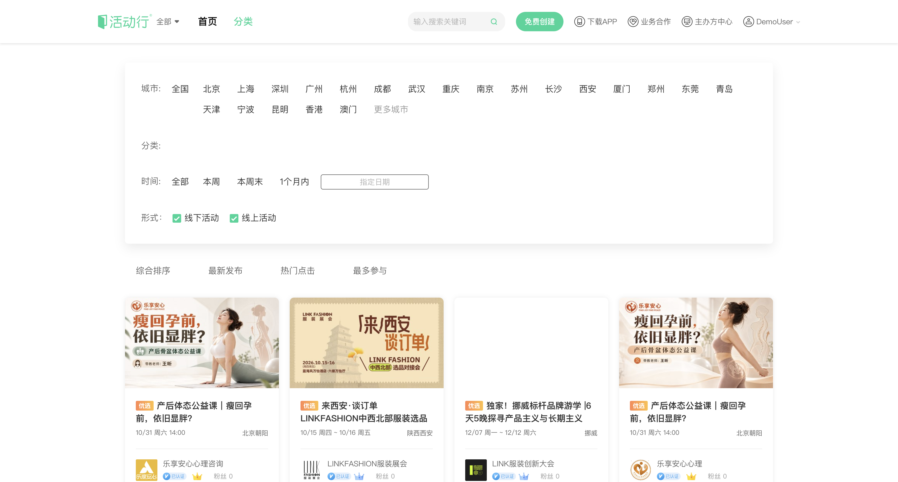 |
| **03. Event Detail** | `GET /event/<id>` | 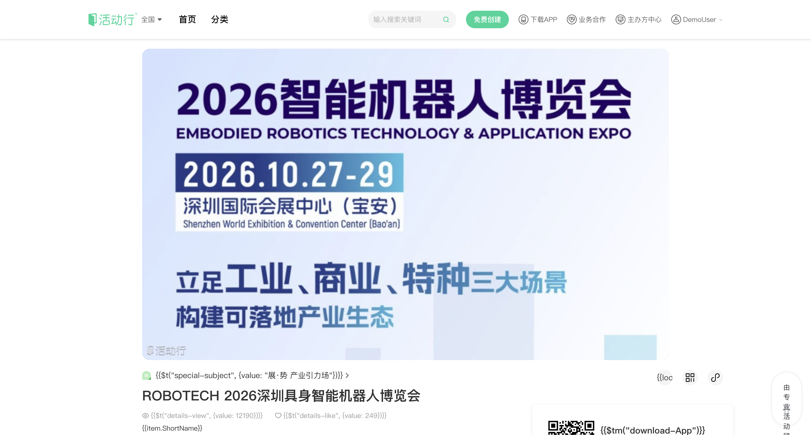 |
| **04. Organizers Directory** | `GET /zhubanfang` | 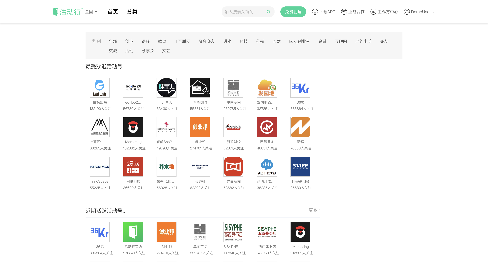 |
| **05. Popularity Ranklist** | `GET /ranklist` | 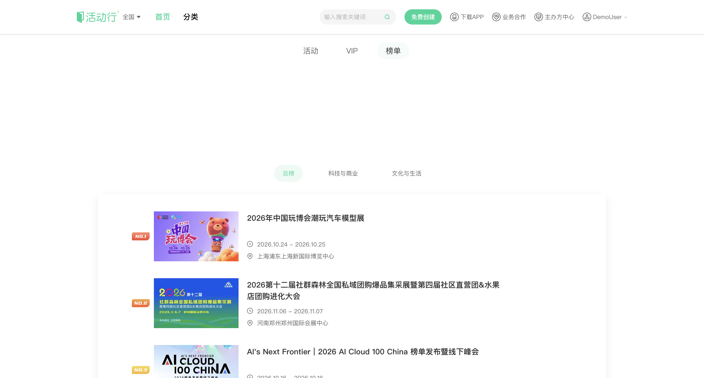 |
| **06. Special Topics** | `GET /topic` | 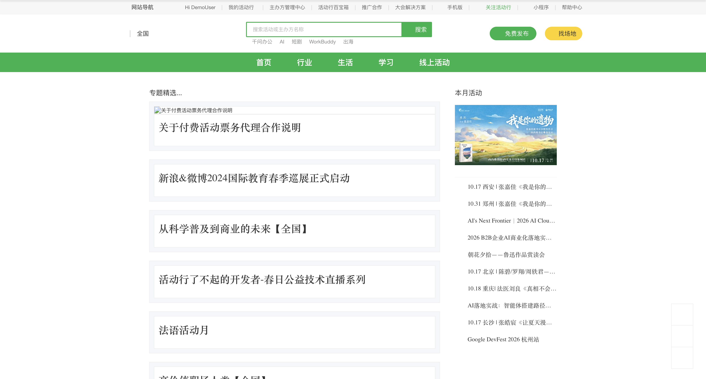 |
| **07. User Timeline** | `GET /user/index` | 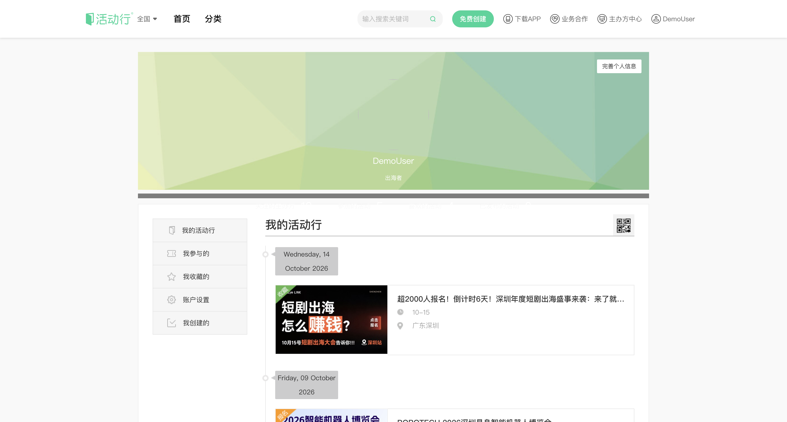 |
| **08. User Tickets** | `GET /user/regevents` | 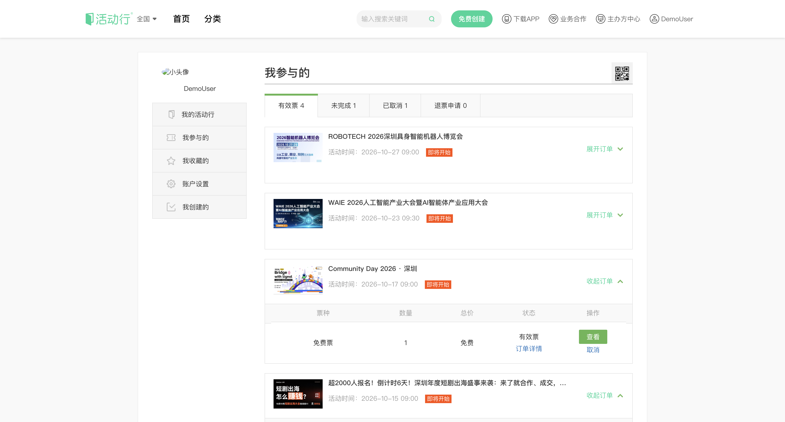 |
| **09. Favorites & Following** | `GET /user/userfollows` | 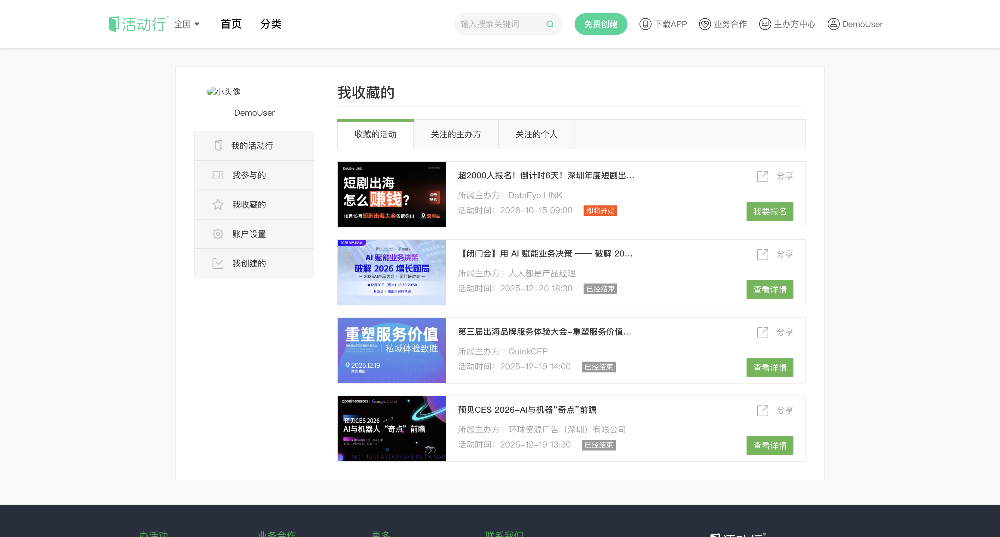 |
| **10. Account Profile** | `GET /account/profile` | 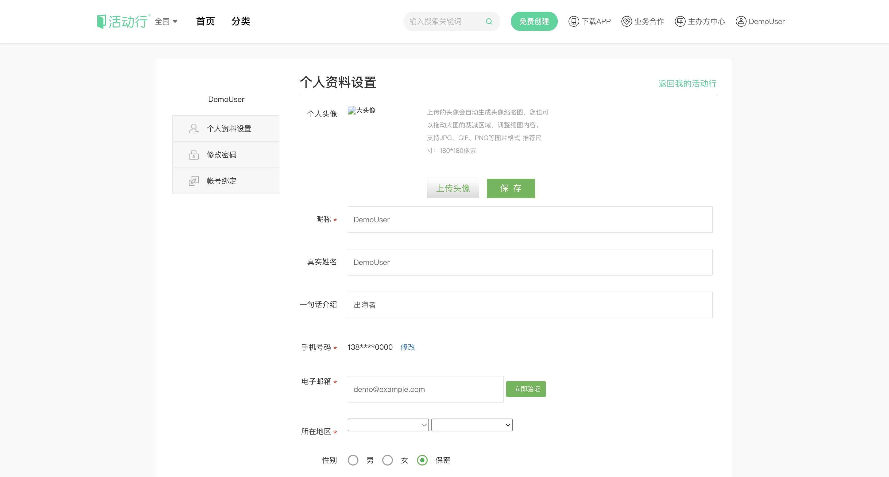 |
| **11. Console Home** | `GET /console/home` | 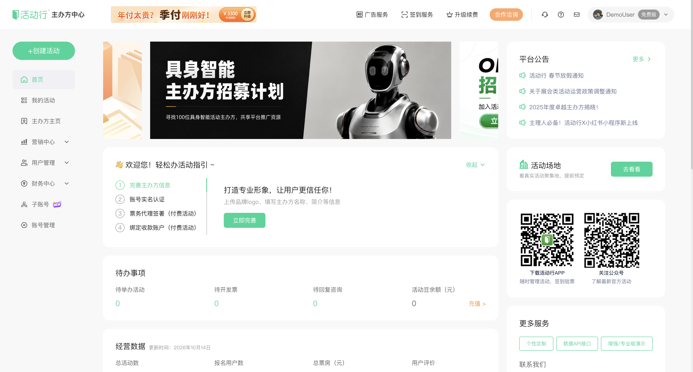 |
| **12. Console EventAdmin** | `GET /console/eventadmin` | 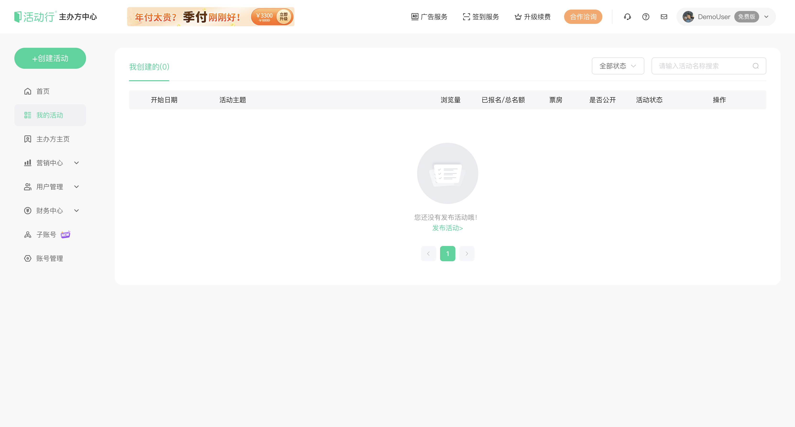 |
| **13. Web Console: Regional Recommendations (佛山·广州·深圳)** | `hdx serve` (`/#recommend`) | 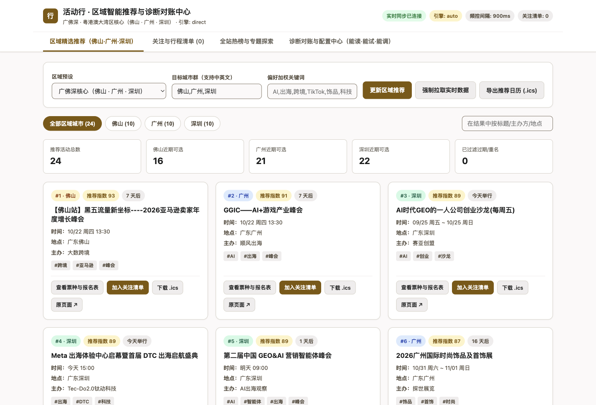 |
| **14. Web Console: Diagnostic Center (能读·能试·能调)** | `hdx serve` (`/#diagnose`) | 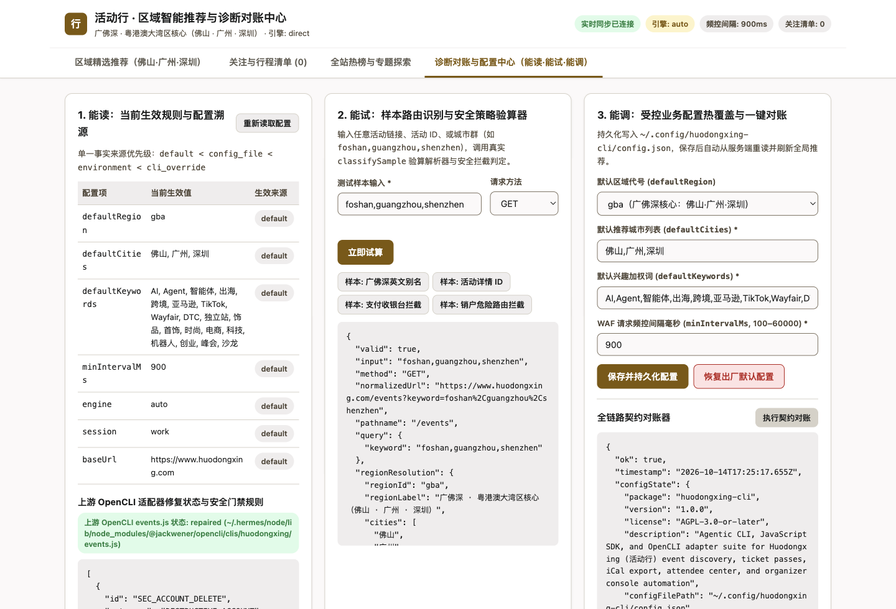 |

---

## 🧪 Testing & Verification

```bash
# Run unit, server, watchlist & browser E2E test suite
npm test

# Run 16-step live E2E production smoke test suite
npm run smoke
```

---

## 📄 License

Licensed under the **GNU Affero General Public License v3.0 or later (`AGPL-3.0-or-later`)**. See [LICENSE](LICENSE) for the full text.
