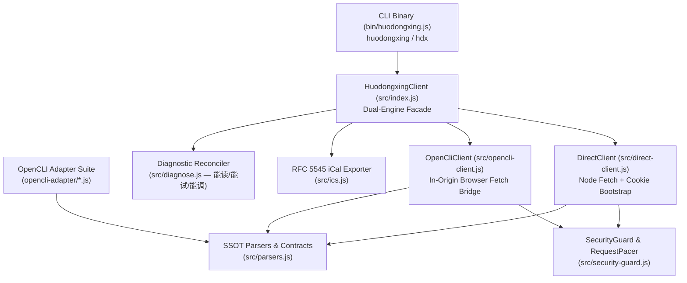

# System Architecture — `huodongxing-cli` (`huodongxing` / `hdx`)

## 1. System Purpose & Boundaries

`huodongxing-cli` provides a Single Source of Truth (SSOT) programmatic CLI, Node.js SDK, and OpenCLI adapter suite for **Huodongxing (活动行 · `https://www.huodongxing.com/`)**. It covers all 12 functional areas across Public Discovery, Authenticated Attendee User Center, and Organizer Console while enforcing strict pre-socket security rules and WAF rate-limit pacing.

## 2. Module Ownership

| File | Responsibility |
| :--- | :--- |
| `src/version.js` | SSOT package version, name, license, and description from `package.json`. |
| `src/security-guard.js` | Pre-socket `SECURITY_ROUTE_DENYLIST` enforcement (`assertSafeRoute`, `inspectRouteSafety`, `assertSafeCliAction`) and sequential token-bucket `RequestPacer` (`minIntervalMs: 900`). |
| `src/parsers.js` | Pure deterministic HTML & inline SSR JSON parsers (`ativityJson`, `eventTicketsJson`, `formItemsJson`, `mUserState`, `currentUser`) and `buildEventsUrl` (fixing the `d=ts` HTTP 500 bug). |
| `src/direct-client.js` | Direct HTTP engine with `HDXWAFID` cookie capture and Geetest v3 WAF redirect detection. |
| `src/opencli-client.js` | OpenCLI Browser Bridge client executing in-origin `fetch()` via `opencli browser <session> eval`. |
| `src/ics.js` | RFC 5545 `.ics` calendar generator for attendee tickets with `UTC+8` (`Asia/Shanghai`) conversion. |
| `src/diagnose.js` | Diagnostic-First observability (`resolveRuntimeConfig`, `updateOperatorConfig`, `classifySample`, `runDiagnosticReconcile`). |
| `src/formatters.js` | Multi-format output renderers (`json`, `table`, `md`, `csv`). |
| `src/index.js` | Unified `HuodongxingClient` facade and SDK exports. |
| `bin/huodongxing.js` | Executable CLI entrypoint (`huodongxing` & `hdx`). |
| `opencli-adapter/` | SSOT-delegating OpenCLI command definitions mirrored to `~/.opencli/clis/huodongxing/`. |

## 3. Reverse-Engineered Platform Contracts (`rea` AST Analysis)

- **SSR + Inline JSON Architecture**: Huodongxing serves C# ASP.NET MVC Razor pages with embedded JSON variables (`var ativityJson`, `var eventTicketsJson`, `var formItemsJson`, `var mUserState`, `var currentUser`).
- **Organizer Console API (`api.huodongxing.com`)**: Uses Hawk SHA-256 MAC headers (`Authorization: Hawk id="...", ts="...", nonce="...", mac="..."`) signed with `localStorage.getItem('appId')` and `localStorage.getItem('appToken')`.
- **OpenResty / Geetest v3 WAF Envelope**: Unpaced bursts exceeding **8 requests per 20-second window** trigger a `302` redirect to `https://verify.huodongxing.com/gt3`. `RequestPacer` defaults to `900ms` sequential spacing to remain safely below this limit.
- **Date Filter Contract (`d=ts`)**: Passing `d=ts` on `/events` without `date` or `dateTo` causes a backend `NullReferenceException` (HTTP 500). `buildEventsUrl` only sets `d=ts` when a date bound is present.
